  

<h1 align="center">마리음 · Marieum</h1>

<strong>당신의 말을 더 또렷하게 이어주는 AI 기반 음성 AAC 서비스</strong>

구음장애가 있는 사용자의 발화를 텍스트로 확인하고, 상황에 맞는 문장을 선택해 음성으로 전달합니다.

  
  
  
  
  
  
  
  

  <a href="#서비스-소개">서비스 소개</a> ·
  <a href="#서비스-아키텍처">아키텍처</a> ·
  <a href="#파트별-역할과-책임">파트별 역할</a> ·
  <a href="#tech-stack">기술 스택</a> ·
  <a href="#파트별-트러블슈팅">트러블슈팅</a> ·
  <a href="#repositories">저장소</a>

---

## 서비스 소개

**마리음은 구음장애인의 일상적인 의사소통을 돕는 보완대체의사소통(AAC) 서비스입니다.**

발음이 명확하지 않아 같은 말을 반복해야 하는 순간, 하고 싶은 말을 문장판에서 찾는 데 시간이 걸리는 순간을 줄이고자 합니다. 사용자의 발화를 출발점으로 **음성 인식 → 내용 확인·문장 추천 → 음성 전달**을 연결합니다.

AI가 사용자의 의도를 대신 확정하기보다, 인식한 내용과 추천 문장을 확인하고 선택할 수 있는 경험을 지향합니다. 정확도 모드와 실시간 모드는 서로 다른 대화 상황에 맞춘 두 가지 사용 흐름입니다.

### 두 가지 대화 방식

| | 정확도 모드 | 실시간 모드 |
| :--- | :--- | :--- |
| 사용 상황 | 한 문장씩 확인하며 전달하고 싶을 때 | 대화의 흐름을 이어가고 싶을 때 |
| 입력 | 버튼을 누르는 동안 녹음 후 WAV 업로드 | 마이크 음성을 WebSocket으로 연속 전송 |
| 처리 | 전사 후 서버 응답에 따라 원문·추천·후보·재발화 안내 표시 | 중간 전사와 발화 구간별 최종 전사 표시 |
| 전달 | 사용자가 확인·선택한 문장을 TTS로 재생 | 확정 문장을 재생 큐에 넣어 순차적으로 전달 |

> ‘정확도 모드’는 확인·추천 중심의 사용 흐름을 가리키는 이름이며, 실시간 모드보다 높은 인식 정확도를 보장한다는 뜻은 아닙니다.

### 대화를 돕는 기능

- **상황에 맞는 문장 추천:** 인식 결과와 개인화 문맥을 바탕으로 추천 문구와 이유를 제공합니다.
- **빠른 문장:** 자주 쓰는 문장을 저장하고 한 번 눌러 재생합니다.
- **요청 기록과 개인화 현황:** 이전 문장을 다시 전달하고 사용 기록을 확인합니다.
- **사용자에게 맞춘 화면·음성:** 큰 글자, 한국어 목소리, 재생 속도와 음량을 설정합니다.
- **모바일 음성 경험:** Android·iOS의 마이크 권한, 녹음·재생 상태, 인증 만료와 재시도를 처리합니다.

### 서비스 화면

<table>
  <tr>
    <th align="center">말하기</th>
    <th align="center">추천 문장 선택</th>
    <th align="center">실시간 대화</th>
  </tr>
  <tr>
    <td align="center"></td>
    <td align="center"></td>
    <td align="center"></td>
  </tr>
</table>

App 저장소에 공개된 iOS 시뮬레이터 캡처입니다. 캡처 시점과 최신 구현 사이에 문구·배치 차이가 있을 수 있습니다.

## Tech Stack

| 영역 | 기술 | 적용 내용 |
| :--- | :--- | :--- |
| **App** |    | Android·iOS 단일 코드베이스, 화면 상태와 녹음·재생 상태 분리, Dio·WebSocket 통신, iOS 네이티브 오디오 플러그인 |
| **Backend API** |       | REST·WebSocket API, ASR HTTP/WS 프록시, asyncpg 비동기 DB 접근, 스키마 마이그레이션, JWT 인증·scrypt 해시 |
| **AI · 문장 추천** |    | 구조화 출력을 강제한 추천 Agent, ko-sroberta 768차원 임베딩, 신뢰도 분기와 LLM → 규칙 랭커 → 기본 문장 3단 fallback |
| **AI · 음성 인식** |      | 구음장애 파인튜닝 whisper-small fp16 추론, 세션별 VAD 구간 분리, 최대 4건 배치·final 우선 GPU 스케줄링 |
| **Data** |    | 발화 기록·환자 선호와 임베딩을 한 DB에서 관리, IVFFlat 코사인 검색, PostgreSQL 컨테이너 운영 |
| **Infra · Ops** |      | NCP GPU Server에 ML 서버 배포, systemd 자동 재시작, iptables로 백엔드 서버만 접근 허용, SSL VPN 경유 관리, /healthz 준비 상태 확인 |
| **Quality** |    | GPU 없이 도는 가짜 엔진 테스트, 실시간·추천 레이어 import 격리 린트, uv 가상환경 |

## 서비스 아키텍처

마리음은 **모바일 경험**, **서비스 API·개인화 추천**, **GPU 음성 인식**을 분리합니다. 앱은 백엔드를 통해 음성 인식 서버와 통신하고, 추천·기록·인증은 백엔드가 담당합니다.

  

  <a href="https://github.com/team-agent-5/.github/blob/main/profile/assets/marieum-architecture.svg">확대해서 보기</a> ·
  <a href="https://github.com/team-agent-5/.github/raw/main/profile/assets/marieum-architecture.html">인터랙티브 HTML 원본</a> ·
  <a href="https://github.com/team-agent-5/.github/blob/main/profile/assets/candidate.json">Archify 소스</a>

Archify로 구성한 시스템 설명입니다. HTML 원본은 내려받아 브라우저에서 열면 구성 요소와 연결을 탐색할 수 있습니다. 그림의 ASR 일괄·스트리밍 블록은 같은 AI 서비스의 두 경로를 구분한 것입니다.

### 1. 정확도 모드: 확인하고 선택하는 흐름

1. **앱**이 PCM 음성을 메모리에 모아 WAV로 구성하고 `POST /phrase/transcribe`로 보냅니다.
2. **백엔드**가 ASR 서버에 전사를 요청하고, 전사 결과·신뢰도·추적 ID를 앱에 전달합니다.
3. 앱이 `POST /phrase/suggest`를 호출하면 **추천 계층**이 신뢰도와 개인화 문맥에 따라 응답을 구성합니다.
4. 앱은 `proactive / candidates / single / retry` 응답에 맞춰 화면과 재생을 처리합니다. 신뢰도 임계값을 앱에서 다시 계산하지 않습니다.
5. 선택한 문장을 TTS로 전달하고 `POST /phrase/selection`으로 선택·거부 기록을 보냅니다.

### 2. 실시간 모드: 대화가 이어지는 흐름

1. **앱**이 PCM16·16 kHz·mono 음성을 100 ms 프레임으로 `/ws/phrase/stream`에 전송합니다.
2. **백엔드**가 별도 GPU ASR 서버로 스트리밍을 중계합니다.
3. **ASR 서버**가 VAD와 반복 전사를 이용해 중간 결과와 발화 구간별 최종 결과를 반환합니다.
4. **앱**이 중간 결과를 표시하고 확정 문장을 순차 재생합니다. 사용 가능한 음성 캐시가 없으면 기기 TTS를 사용합니다.
5. 재생 후 `POST /phrase/bypass`로 기록합니다. 기록 전송이 다음 음성 재생을 막지 않도록 분리합니다.

> 실시간 기본 경로는 ASR 결과의 중계·표시·음성 전달입니다. 모든 실시간 발화가 LLM 문장 추천이나 교정을 거치는 구조는 아닙니다.

## 파트별 역할과 책임

기술을 나열하는 데 그치지 않고, **각 파트가 어떤 문제를 해결하고 어디까지 책임지는지**를 기준으로 구분합니다.

| 파트 | 해결하는 문제와 책임 | 주요 구현·산출물 |
| :--- | :--- | :--- |
| **서비스 기획 · UX** | 구음장애 사용자의 의사소통 흐름을 정의하고, 확인 중심 대화와 실시간 대화를 구분 | 모드별 사용자 흐름, 큰 말하기 버튼·후보 선택·재시도 안내, 접근성을 고려한 화면 구성 [화면·UX 이슈](https://github.com/team-agent-5/marieum-app#troubleshooting) |
| **모바일 앱** | 녹음부터 문장 확인·선택·음성 재생까지의 사용자 경험을 안정적으로 연결 | Flutter UI, BLoC/Cubit 상태 관리, HTTP·WebSocket 연결, 플랫폼별 오디오 처리, TTS, 보안 토큰 저장 [앱 트러블슈팅](https://github.com/team-agent-5/marieum-app#troubleshooting) |
| **백엔드 · 서비스 연동** | 앱과 AI 서버 사이의 계약을 관리하고 인증·기록·설정 기능 제공 | FastAPI API, JWT 인증, ASR HTTP·WebSocket 프록시, 데이터 저장, 요청 추적 [서버 연동 트러블슈팅](https://github.com/team-agent-5/marieum-ai/blob/main/BACKEND_FAQ.md#4-연결-지연과-keep-alive) |
| **개인화 추천** | 인식 결과만으로 부족한 문맥을 보완하고 선택 가능한 문장 제공 | pgvector 기반 문맥 검색, PydanticAI·Claude 추천, 응답 모드 분기, 선택 피드백과 실패 시 대체 응답 [추천 실패 대응](https://github.com/team-agent-5/marieum-backend#3--정확도-추천-ai-agent) |
| **AI · 음성 인식** | 구음장애 발화를 텍스트로 변환하고 대화 중 전사 결과 제공 | 구음장애 특화 Whisper 모델 연동, Silero VAD, GPU 추론, 중간·최종 전사, 배치 처리와 추론 검증 [ASR 트러블슈팅](https://github.com/team-agent-5/marieum-ai/blob/main/TEST_RESULTS.md#6-무음잡음-환각-시험) |
| **인프라 · 운영** | GPU 추론 서버를 안정적으로 띄우고 외부 접근을 막아 백엔드만 사용하도록 관리 | NCP GPU Server(NVIDIA L4) 배포, systemd 자동 재시작·부팅 시 기동, iptables 접근 제어, /healthz 준비 확인 [ML 서버 운영 문서](https://github.com/team-agent-5/marieum-ai/blob/main/ML_SERVER.md#12-운영) |

위 표는 시스템의 책임 영역입니다. 개인별 담당이나 기여 규모를 임의로 배정하지 않으며, 구체적인 구현 이력은 각 저장소의 커밋·PR에서 확인할 수 있습니다.

### 함께 맞춘 설계 기준

- **음성 인식과 추천의 분리:** ASR은 음성→텍스트를, 백엔드는 문맥 검색·추천·기록을 담당합니다.
- **명확한 API 계약:** 앱이 서버의 응답 모드를 해석해 원문·후보·추천·재시도 화면을 구성합니다.
- **음성 전달 우선:** 재생과 로그 전송을 분리하고, 실시간 모드에서 새 클라우드 합성을 기다리지 않습니다.
- **모델 출처와 검증 범위 구분:** 공개 AI 서버는 공개된 구음장애 특화 Whisper 파인튜닝 모델을 사용하는 추론·서빙 구현입니다. 이 서버의 구현을 팀의 자체 모델 학습 성과로 표현하지 않습니다.

## 파트별 트러블슈팅

구현 과정에서 마주친 문제와 처리 방식을 파트별로 바로 확인할 수 있습니다. 아래 링크는 **실제 저장소의 문제·대응 문서**로 연결됩니다.

  
  
  
  

| 파트 | 마주친 문제 | 처리·설계 포인트 | 바로가기 |
| :--- | :--- | :--- | :--- |
| **앱 · 인증 / 화면** | 잘못 입력한 비밀번호가 전체 세션 만료로 처리되거나 프로필 복원이 실패 | 실제 토큰을 첨부한 요청의 401만 만료 처리하고, null·문자열 응답을 방어적으로 해석 | [앱 Troubleshooting](https://github.com/team-agent-5/marieum-app#troubleshooting) |
| **앱 · 음성 재생** | 선택 로그가 다음 재생을 막거나 화면 종료 후 늦은 콜백이 상태를 변경 | 로그 큐와 재생을 분리하고 타이머 취소·종료 가드 적용 | [오디오·상태 관리 사례](https://github.com/team-agent-5/marieum-app#troubleshooting) |
| **백엔드 · ASR 연결** | 연결을 무조건 재생성하면 지연이 늘고, 한 연결에서 세션을 겹치면 음성이 섞임 | 발화별 연결 또는 순차 세션 재사용. 이전 세션 종료 후 다음 세션 시작 | [연결·keep-alive 규칙](https://github.com/team-agent-5/marieum-ai/blob/main/BACKEND_FAQ.md#4-연결-지연과-keep-alive) |
| **백엔드 · 오디오 계약** | 지원하지 않는 포맷으로 보내면 415 / INVALID_FORMAT 발생 | 앱→백엔드 업로드와 백엔드→ML 원문 바이트 전달을 구분. ML에는 WAV 원문 또는 규격에 맞는 PCM16 전달 | [ML 요청 규격](https://github.com/team-agent-5/marieum-ai/blob/main/BACKEND_NOTICE_20261101.md#3-녹음-파일-전사-post-asr) |
| **개인화 추천** | LLM 실패 또는 허용 문구 밖의 응답 생성 | 허용 후보 검증과 대체 추천 경로를 둬 생성 실패가 바로 서비스 실패로 이어지지 않게 구성 | [추천 구조·fallback](https://github.com/team-agent-5/marieum-backend#3--정확도-추천-ai-agent) · [현재 구현](https://github.com/team-agent-5/marieum-backend/blob/main/src/app/agent/orchestrator.py) |
| **AI · 중간 전사** | 중간 자막을 계속 덧붙여 같은 내용이 반복 누적 | cumulative `text`는 append 대신 교체하고, final 수신 시 확정 문장으로 갱신 | [자막·delta 계약](https://github.com/team-agent-5/marieum-ai/blob/main/BACKEND_FAQ.md#3-text는-delta인가-cumulative인가) |
| **AI · 무음 / 잡음** | 말하지 않았는데 문장이 생성되거나 confidence만으로 환각을 걸러내지 못함 | VAD·무음 확률과 빈 결과 처리를 함께 사용. 잡음 환각은 남아 있어 실제 녹음 기반 검증 필요 | [무음·잡음 시험](https://github.com/team-agent-5/marieum-ai/blob/main/TEST_RESULTS.md#6-무음잡음-환각-시험) · [confidence 분포](https://github.com/team-agent-5/marieum-ai/blob/main/TEST_RESULTS.md#51-confidence-분포) |
| **AI · 문장 경계 / 지연** | 짧은 쉼에서 문장이 끊기고, 대기 시간을 늘리면 지연이 커짐 | 끝 무음·구간 길이를 조정하고 문장 보존과 동시 세션 지연의 trade-off를 측정 | [설정 변경과 측정 결과](https://github.com/team-agent-5/marieum-ai/blob/main/TEST_RESULTS.md#731-끝-무음-175초-구간-15초로-바꿈-2026-11-01) |

문서에 기록된 문제·대응 및 당시 시험 결과입니다. 이미 수정된 과거 현상을 현재 운영 장애로 단정하지 않으며, 세부 정책은 연결된 최신 구현과 함께 확인합니다.

## Repositories

| 저장소 | 담당 영역 | 주요 기술·문서 |
| :--- | :--- | :--- |
| [marieum-app](https://github.com/team-agent-5/marieum-app) | Android·iOS 앱, 녹음·확인·선택·음성 전달 | Flutter · Dart · BLoC/Cubit · 네이티브 오디오 / [실행 및 화면 안내](https://github.com/team-agent-5/marieum-app#readme) |
| [marieum-backend](https://github.com/team-agent-5/marieum-backend) | 인증·기록·설정, ASR 중계, 개인화 추천 | Python · FastAPI · PostgreSQL/pgvector · PydanticAI · Claude / [서버 안내](https://github.com/team-agent-5/marieum-backend#readme) |
| [marieum-ai](https://github.com/team-agent-5/marieum-ai) | 구음장애 음성 인식, 실시간 GPU 추론·서빙 | Whisper · PyTorch · Transformers · Silero VAD / [역할별 연동 가이드](https://github.com/team-agent-5/marieum-ai/blob/main/TEAM_GUIDE.md) |

로컬 실행·환경변수·상세 API 계약은 각 저장소의 문서를 참고해 주세요. 이 페이지는 서비스 전체의 구조와 책임 경계를 소개합니다.

구현 근거와 검증 범위

- [App README](https://github.com/team-agent-5/marieum-app/blob/a12aa847efa5794825da9e6e61cc05c48be30381/README.md): 화면, 정확도·실시간 통신 흐름, TTS와 기록 분리.
- [Backend API](https://github.com/team-agent-5/marieum-backend/blob/0183d995817bc2249ed50bd256401632b603a0bf/src/app/api/phrase.py) · [추천 오케스트레이터](https://github.com/team-agent-5/marieum-backend/blob/0183d995817bc2249ed50bd256401632b603a0bf/src/app/agent/orchestrator.py): 전사·추천·선택·bypass와 개인화 추천 경계.
- [실시간 파이프라인](https://github.com/team-agent-5/marieum-backend/blob/0183d995817bc2249ed50bd256401632b603a0bf/src/app/agent/streaming/pipeline.py): 기본 실시간 중계 경로.
- [AI 연동 가이드](https://github.com/team-agent-5/marieum-ai/blob/2ccebf6627259e6260d17beab6de96889a67f72b/TEAM_GUIDE.md) · [검증 결과](https://github.com/team-agent-5/marieum-ai/blob/2ccebf6627259e6260d17beab6de96889a67f72b/TEST_RESULTS.md): 모델 출처, 추론 방식과 측정 조건.

공개 저장소의 확인된 구현을 기준으로 작성했습니다. 현재 운영 상태, 앱스토어 배포 여부, 의료적 효능이나 특정 정확도·지연 시간을 보장하지 않습니다.

