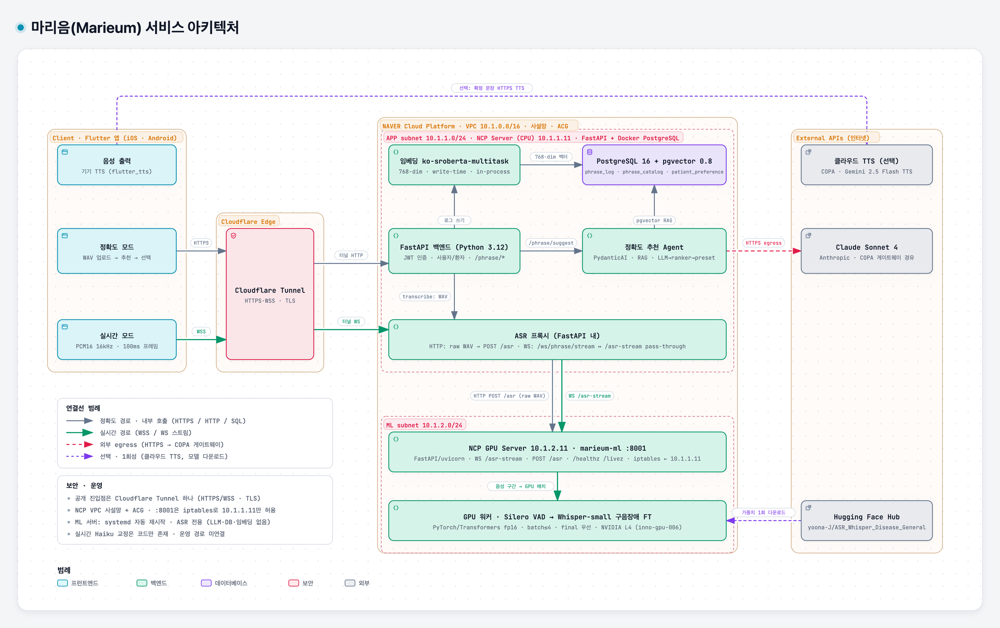
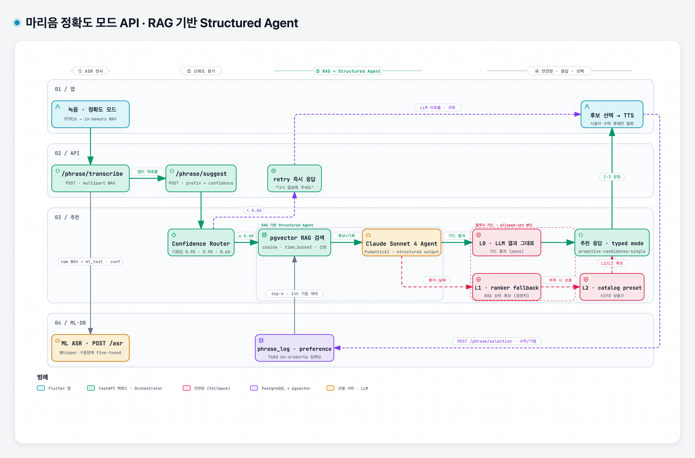
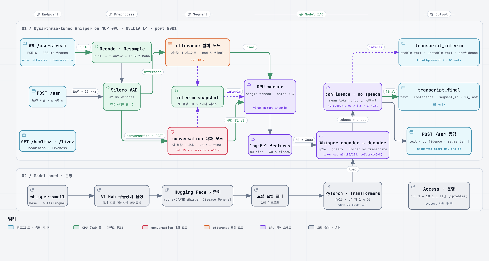

  

<h1 align="center">마리음 · Marieum</h1>

<strong>말하면, 들립니다.</strong> 구음장애 환자를 위한 AI 음성 소통 보조 서비스

  
  
  
  
  
  
  
  
  
  

  <a href="#서비스-소개">서비스 소개</a> ·
  <a href="#시스템-아키텍처">아키텍처</a> ·
  <a href="#tech-stack">기술 스택</a> ·
  <a href="#team">팀</a> ·
  <a href="#트러블슈팅">트러블슈팅</a> ·
  <a href="#repositories">저장소</a>

---

## 서비스 소개

뇌졸중 후유증·퇴행성 신경질환 등으로 **발화는 가능하지만 발음이 불명료한 구음장애 환자**는 같은 말을 반복하다 결국 대화를 포기하곤 합니다. 범용 음성 인식은 구음장애 발화에 취약하고, 기존 AAC는 환자의 목소리 자체를 쓰지 않습니다.

마리음은 환자의 발화를 **구음장애 특화 음성 인식 → 본인 기록 기반 문장 추천 → 또렷한 음성 전달**로 연결합니다. AI 제안은 항상 환자가 확인·수락한 뒤에 전달하고, 음성 원본은 저장하지 않습니다.

| | 정확도 모드 | 실시간 모드 |
| :--- | :--- | :--- |
| 상황 | 한 문장을 정확히 전하고 싶을 때 | 대화를 끊김 없이 이어가고 싶을 때 |
| 입력 | 누르는 동안 녹음 → WAV 업로드 | 버튼 없이 계속 말하기 (WebSocket 스트리밍) |
| 처리 | 신뢰도에 따라 그대로 · 후보 3개 · 복원 1개 · 다시 말하기 | 잠깐 쉴 때마다 확정된 문장 단위로 전달 |
| 전달 | 고른 문장을 TTS로 재생 | 확정 문장을 큐에 넣어 순차 재생 |

<table>
  <tr>
    <th align="center">정확도 모드</th>
    <th align="center">추천 후보 선택</th>
    <th align="center">실시간 모드</th>
  </tr>
  <tr>
    <td align="center"></td>
    <td align="center"></td>
    <td align="center"></td>
  </tr>
</table>

## 시스템 아키텍처

  

- **네트워크 경계:** 앱은 Cloudflare Tunnel(HTTPS/WSS)로 APP 서브넷의 백엔드에만 접근합니다. GPU 서버(ML 서브넷)는 iptables로 백엔드 IP만 허용하고 외부에 노출하지 않습니다.
- **책임 분리:** ML 서버는 음성 → 텍스트만 담당합니다. 임베딩·RAG·LLM 호출·DB는 백엔드, 재생은 앱이 맡습니다.
- **외부 의존:** Claude Sonnet 4는 COPA 게이트웨이로 백엔드에서만 호출하고, 모델 가중치는 Hugging Face에서 한 번 내려받아 로컬로 서빙합니다.

### 정확도 모드 · 추천 API

  

- `/phrase/transcribe`로 받은 ASR 신뢰도에 따라 **그대로+제안 · 후보 3개 · 복원 1개 · 다시 말하기**로 분기합니다. 다시 말하기 분기는 LLM을 호출하지 않습니다.
- 추천은 환자 **본인 기록만** 검색(pgvector 코사인·시간대·선호·24시간 내 거부 제외)해 구조화 출력 Agent에 근거로 넘깁니다.
- 생성 결과는 allowed-set 검사를 통과해야 하며, 실패하면 결정론 랭커 → 프리셋 순으로 강등합니다. 선택·거부 기록은 다음 추천의 근거가 됩니다.

### ASR 서버

  

- 공개 구음장애 파인튜닝 모델(`yoona-J/ASR_Whisper_Disease_General`, whisper-small)을 NCP L4 GPU에서 fp16으로 서빙합니다. 모델 학습이 아닌 **실시간 서빙 구조**를 직접 설계·구현했습니다.
- 이벤트 루프 1 · VAD 스레드 2 · GPU 스레드 1로 나누고, GPU 작업은 최대 4건 배치·final 우선으로 스케줄링합니다.
- 실시간 모드는 1.75초 쉼마다 구간 final을 보내고, 중간 결과는 LocalAgreement-2로 확정/미확정 텍스트를 나눠 자막 흔들림을 줄입니다.

세 도식은 [Archify](https://github.com/tt-a1i/archify)로 작성했습니다. 이미지를 누르면 SVG로 열리고, 인터랙티브 원본은 [assets](https://github.com/team-agent-5/.github/tree/main/profile/assets)에 있습니다.

## Tech Stack

| 영역 | 기술 | 적용 내용 |
| :--- | :--- | :--- |
| **App** |        | Clean Architecture(data·domain·presentation), 녹음·재생·추천 상태를 BLoC/Cubit으로 분리, iOS 단일 오디오 엔진 플러그인(duplex_audio), 보안 토큰 저장·401 만료 처리 |
| **Backend** |        | REST·WebSocket API, ASR HTTP/WS 프록시와 ML 재연결, asyncpg 비동기 DB, 스키마 마이그레이션, JWT 인증·scrypt 해시 |
| **AI · 추천** |      | 신뢰도 4분기 라우팅, 환자 본인 기록 기반 RAG(768차원 코사인), 구조화 출력 Agent, 환각 가드와 LLM → 랭커 → 프리셋 3단 fallback |
| **AI · 음성 인식** |      | 구음장애 파인튜닝 Whisper 서빙, 세션별 VAD 구간 분리, 최대 4건 배치·final 우선 GPU 스케줄링, 오디오 길이 기반 토큰 상한 |
| **Infra · Data** |        | NCP VPC를 APP·ML 서브넷으로 분리, GPU 서버는 백엔드 IP만 허용, systemd 자동 재시작, pgvector 컨테이너, Tunnel로 API 외부 공개 |
| **Quality** |     | 앱 단위 테스트·정적 분석, GPU 없이 도는 가짜 엔진 테스트, 실시간·추천 레이어 import 격리 린트 |

## Team

앱 · 백엔드 · AI를 나눠 맡고, API 계약으로 하나의 서비스로 연결했습니다.

| 포지션 | 팀원 | 담당 | 저장소 | 트러블슈팅 |
| :--- | :--- | :--- | :--- | :--- |
| **App** | 정빈 (팀장) [@b0e2](https://github.com/b0e2) | Flutter 앱 전체, 녹음·재생 오디오 파이프라인, iOS 네이티브 오디오 플러그인, 정확도·실시간 모드 UI | [marieum-app](https://github.com/team-agent-5/marieum-app) | [App](#app-트러블슈팅) |
| **Backend** | 차의진 [@jeenee-cha](https://github.com/jeenee-cha) | FastAPI 백엔드, 인증·기록 API, ASR 프록시, 정확도 모드 추천 Agent(RAG) | [marieum-backend](https://github.com/team-agent-5/marieum-backend) | [Backend](#backend-트러블슈팅) |
| **AI** | 남정현 [@NamJungHyeon](https://github.com/NamJungHyeon) · 권현석 [@wp230](https://github.com/wp230) · 송연우 [@song0423ricky](https://github.com/song0423ricky) | 음성 인식 모델 조사·검증, GPU ASR 서버 구현·배포·운영 | [marieum-ai](https://github.com/team-agent-5/marieum-ai) | [AI](#ai-트러블슈팅) |

## 트러블슈팅

  
  
  

각 항목은 **문제 → 원인 → 해결 → 결과·한계** 순서로 적고, 실제 PR·코드·시험 기록으로 연결했습니다.

### App 트러블슈팅

| 문제 | 원인 | 해결 | 결과·한계 | 근거 |
| :--- | :--- | :--- | :--- | :---: |
| 앱이 읽은 문장이 다시 인식돼 같은 말이 반복됨 | 스피커 출력이 마이크로 재유입. iOS는 녹음·재생 엔진이 분리돼 시스템 에코 제거가 적용되지 않음 | iOS: 녹음·재생을 하나의 AVAudioEngine으로 처리하는 Swift 플러그인 `duplex_audio` 작성. Android: VOICE_COMMUNICATION 경로와 재생 중 무음 전송(연결 유지) | 두 플랫폼 모두 "재생 중 입력 차단"으로 동작 통일 | [#52](https://github.com/team-agent-5/marieum-app/pull/52) [#72](https://github.com/team-agent-5/marieum-app/pull/72) [#104](https://github.com/team-agent-5/marieum-app/pull/104) |
| 실시간 모드에서 문장이 잘리거나 서버 final 이후 말이 유실됨 | 앱이 문장을 직접 자르고 조각마다 연결을 새로 열어, 문장 경계 판단이 앱·서버에 이중화 | `/ws/phrase/stream` 단일 연결 유지, 문장 경계는 서버 final로 일원화, 재연결 중 최근 3초 오디오 버퍼링 | 앱의 분할·병합 로직 제거로 상태 단순화 | [#46](https://github.com/team-agent-5/marieum-app/pull/46) [#60](https://github.com/team-agent-5/marieum-app/pull/60) |
| 말하지 않았는데 문장이 생성돼 읽힘 | 방 소음·잡음 구간에서 ASR 환각 | 입력 레벨이 소음 기준선 +6dB(최소 −40dBFS)를 넘은 구간을 기록해, 목소리가 0.3초 미만인 final은 폐기 | 서버 VAD와 별도로 클라이언트 2차 방어선 확보 | [#94](https://github.com/team-agent-5/marieum-app/pull/94) |
| final에 같은 구절이 반복돼 어색하게 읽힘 | Whisper 반복 출력 | 4글자 이상 구절이 연속 반복되고 마지막 interim이 정상이면 interim으로 대체 | 근본 대응은 서버 토큰 상한(AI #6)과 병행 | [#110](https://github.com/team-agent-5/marieum-app/pull/110) |
| 추천이 3초 만에 끊겨 "맞는 문장 없음"으로 이동 | LLM 추천 지연 대비 짧은 클라이언트 타임아웃 | 대기 8초로 조정, 실패 시 들린 문장을 후보 1개로 제시하고 출처 `asr_verbatim`으로 기록 | 추천 실패가 대화 중단으로 이어지지 않음 | [#80](https://github.com/team-agent-5/marieum-app/pull/80) |
| 비밀번호 오류가 세션 만료로 처리됨 | 모든 401을 만료로 해석 | 토큰을 첨부한 요청의 401만 만료로 발행, 403·409·413·415·422를 Failure 타입으로 구분 | 로그인 실패와 세션 만료 분리 | [#6](https://github.com/team-agent-5/marieum-app/pull/6) · [README](https://github.com/team-agent-5/marieum-app#troubleshooting) |

### Backend 트러블슈팅

| 문제 | 원인 | 해결 | 결과·한계 | 근거 |
| :--- | :--- | :--- | :--- | :---: |
| LLM이 환자 기록에 없는 문장을 만들어냄 | 생성 결과를 그대로 응답에 사용 | 서버에서 allowed-set(NFC 정규화) 포함 여부를 검사하고, 벗어나면 결정론 랭커로 강등 | 응답 문장이 항상 환자 기록·카탈로그 안에 있음 | [README](https://github.com/team-agent-5/marieum-backend#3--정확도-추천-ai-agent) |
| LLM 장애·지연 시 추천이 비어 버림 | 외부 API 단일 의존 | LLM → 결정론 랭커 → 카탈로그 프리셋 3단 fallback, 낮은 신뢰도(retry 분기)는 LLM을 호출하지 않음 | 외부 API 장애에도 1~3개 선택지 유지 | [orchestrator.py](https://github.com/team-agent-5/marieum-backend/blob/0183d995817bc2249ed50bd256401632b603a0bf/src/app/agent/orchestrator.py) |
| 대화 모드에서 첫 final 이후 인식 결과가 끊길 위험 | ML conversation 모드는 구간마다 final을 여러 번 보냄 | `is_last`까지 수신을 유지하고 `segment_id`를 보존해 앱으로 중계 | 긴 대화도 구간 단위로 연속 전달 | [ml_proxy.py](https://github.com/team-agent-5/marieum-backend/blob/0183d995817bc2249ed50bd256401632b603a0bf/src/app/agent/streaming/ml_proxy.py) |
| ML 서버 재시작·연결 끊김 시 실시간 세션이 종료됨 | 앱 ↔ 백엔드 ↔ ML 이중 WebSocket 중 한쪽 장애가 전파 | 세션 안에서 ML 재연결을 시도하고 실패를 구조화 로그로 남김 | 일시 장애를 세션 유지로 흡수 | [session.py](https://github.com/team-agent-5/marieum-backend/blob/0183d995817bc2249ed50bd256401632b603a0bf/src/app/agent/streaming/session.py) |
| 실시간 경로와 추천 Agent가 얽혀 지연·장애가 전파될 위험 | 두 레이어가 모듈을 공유할 수 있는 구조 | Ruff `TID251` 금지 규칙과 AST 기반 격리 테스트로 상호 import 차단 | 실시간 경로는 LLM 의존 없이 동작 | [test_isolation.py](https://github.com/team-agent-5/marieum-backend/blob/0183d995817bc2249ed50bd256401632b603a0bf/tests/test_isolation.py) |
| 신규 사용자가 몇 번 거부한 문구가 하루 종일 억제됨 | 이력 수와 무관한 고정 거부 패널티(콜드 유저 과적합) | Beta-binomial 스무딩 `freq / (freq + K)`로 패널티와 하한을 이력에 비례하게 조정, 단위 테스트 14개 | PR 리뷰 중 | [#1](https://github.com/team-agent-5/marieum-backend/pull/1) |

### AI 트러블슈팅

| 문제 | 원인 | 해결 | 결과·한계 | 근거 |
| :--- | :--- | :--- | :--- | :---: |
| 짧은 조각에서 같은 말이 반복되며 토큰 상한까지 생성 | 배치 전체가 하나의 상한을 공유하고, pad 토큰이 EOT와 같은 id라 상한 도달을 정상 종료로 오인 | 작업별 `min(상한, ceil(초 × 14) + 8)` 토큰 상한, 앞 cap개 토큰만 보고 종료 판정 | 긴 구간 반복 루프는 별도 과제 | [#6](https://github.com/team-agent-5/marieum-ai/pull/6) |
| 동시 세션에서 VAD가 병목 | VAD 모델을 4개 미리 만든다는 코드가 실제로는 1개만 생성(풀에서 방금 넣은 모델을 다시 꺼냄) | 일괄 생성 후 풀에 추가 | 동시 4세션 에러 0, utterance final p50 153ms | [#3](https://github.com/team-agent-5/marieum-ai/pull/3) |
| 대화 중 문장이 너무 일찍 끊김 | 끝 무음 800ms·구간 상한 6초 | 끝 무음 1.75초·구간 상한 15초로 조정 | 문장 보존은 개선, 동시 4세션 interim p95 1132ms로 지연과 trade-off | [#5](https://github.com/team-agent-5/marieum-ai/pull/5) · [측정](https://github.com/team-agent-5/marieum-ai/blob/main/TEST_RESULTS.md#731-끝-무음-175초-구간-15초로-바꿈-2026-11-01) |
| 말하지 않았는데 문장이 생성됨 | Whisper의 무음·잡음 환각 | Silero VAD + `no_speech_prob > 0.6`이면 빈 결과, 빈 final은 추천·TTS로 넘기지 않음 | 잡음 환각은 남아 실제 녹음 검증 필요 | [시험](https://github.com/team-agent-5/marieum-ai/blob/main/TEST_RESULTS.md#6-무음잡음-환각-시험) |
| confidence로 환각을 걸러낼 수 없음 | 정상 조각 중앙값 0.9996, 잡음 환각도 0.43~0.73 | confidence는 정확도가 아닌 분기 기준으로만 쓰고, 빈 final 처리를 우선 | 백엔드 분기 기준 재보정 근거 제공 | [분포](https://github.com/team-agent-5/marieum-ai/blob/main/TEST_RESULTS.md#51-confidence-분포) |
| 실시간 자막이 흔들리고 앞부분이 계속 바뀜 | 누적 음성을 반복 재전사해 앞 단어가 변동 | LocalAgreement-2로 stable/unstable 분리, `stable_delta`·`stable_revised` 필드 추가 | 60초 녹음 final 5개 중 1개만 수정 발생 | [#5](https://github.com/team-agent-5/marieum-ai/pull/5) |

당시 PR·시험 기록 기준입니다. 측정값은 GPU 서버 내부 기준이며 앱·네트워크 지연을 포함하지 않습니다.

## Repositories

| 저장소 | 역할 | 주요 문서 |
| :--- | :--- | :--- |
| [marieum-app](https://github.com/team-agent-5/marieum-app) | Flutter 환자 앱 (iOS · Android) | [README](https://github.com/team-agent-5/marieum-app#readme) |
| [marieum-backend](https://github.com/team-agent-5/marieum-backend) | FastAPI 백엔드 · 추천 Agent | [README](https://github.com/team-agent-5/marieum-backend#readme) |
| [marieum-ai](https://github.com/team-agent-5/marieum-ai) | GPU ASR 서버 | [ML_SERVER](https://github.com/team-agent-5/marieum-ai/blob/main/ML_SERVER.md) · [TEST_RESULTS](https://github.com/team-agent-5/marieum-ai/blob/main/TEST_RESULTS.md) · [TEAM_GUIDE](https://github.com/team-agent-5/marieum-ai/blob/main/TEAM_GUIDE.md) |

표기 기준

- 신뢰도 임계값(0.98 / 0.90 / 0.60)은 설정값 기반 분기 기준이며 인식 정확도 실측치가 아닙니다.
- 지연·처리량 수치는 GPU 서버 내부 측정으로 앱 녹음·네트워크 구간을 포함하지 않습니다.
- 실시간 Haiku 교정 모듈은 코드에 보존돼 있지만 운영 실시간 경로에는 연결하지 않았습니다.
- 공개 저장소의 코드·PR·문서를 기준으로 작성했습니다.

